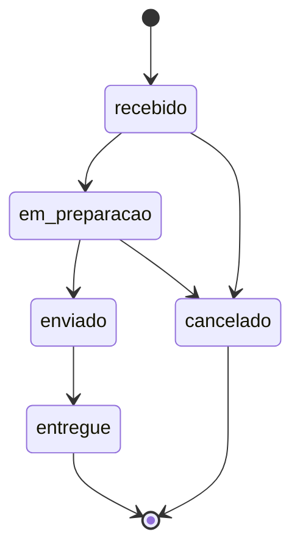

# API de Gerenciamento de Pedidos

API REST para gerenciar os pedidos de uma pequena loja: cadastrar, listar, consultar e atualizar o status de pedidos.
Projeto prático da disciplina **Tópicos Avançados em Sistemas de Informação II**.

- **Aluno(a):** Oto Passos
- **RA:** 44627246

## Tecnologias

| Ferramenta | Uso |
| --- | --- |
| Node.js (18 ou superior) + JavaScript | Plataforma e linguagem |
| Express 5 | Framework HTTP |
| Jest + Supertest | Testes automatizados (unitários e de integração) |
| Postman | Testes manuais e evidências |
| Git + GitHub | Versionamento |

Os pedidos ficam **armazenados em memória** (não há banco de dados). Ao reiniciar o servidor, a lista volta a ficar vazia e os ids recomeçam em 1.

## Como instalar e executar

```bash
# 1. Clonar o repositório
git clone https://github.com/otoprb/api-pedidos.git
cd api-pedidos

# 2. Instalar as dependências
npm install

# 3. Iniciar a API
npm start
```

A API sobe em `http://localhost:3000`. Para usar outra porta: `PORT=4000 npm start` (Linux/macOS) ou `set PORT=4000 && npm start` (Windows/cmd).

Outros comandos:

| Comando | O que faz |
| --- | --- |
| `npm test` | Roda os testes automatizados (Jest) |
| `npm run dev` | Inicia a API e reinicia sozinha a cada alteração no código |

## Rotas

| Método | Rota | Descrição | Respostas |
| --- | --- | --- | --- |
| `POST` | `/pedidos` | Cadastra um pedido (RF01) | `201` criado · `400` dados inválidos |
| `GET` | `/pedidos` | Lista todos os pedidos (RF02) | `200` |
| `GET` | `/pedidos/:id` | Consulta um pedido pelo id (RF03) | `200` encontrado · `404` inexistente |
| `PATCH` | `/pedidos/:id/status` | Atualiza o status (RF04) | `200` atualizado · `400` status ou transição inválidos · `404` inexistente |

Rotas que não existem (ex.: `GET /produtos`) respondem `404` em JSON.

## Exemplos

### Cadastrar pedido

```http
POST /pedidos
Content-Type: application/json

{
  "cliente": "Carlos Silva",
  "tipo": "entrega",
  "valor": 350,
  "prioridade": "normal"
}
```

Resposta `201 Created` (com o cabeçalho `Location: /pedidos/1`):

```json
{
  "id": 1,
  "cliente": "Carlos Silva",
  "tipo": "entrega",
  "valor": 350,
  "prioridade": "normal",
  "status": "recebido"
}
```

### Cadastro com dados inválidos

```http
POST /pedidos
Content-Type: application/json

{ "cliente": "   ", "tipo": "entrega", "valor": -50, "prioridade": "urgentissima" }
```

Resposta `400 Bad Request` — todos os problemas são listados de uma vez:

```json
{
  "erro": "Dados do pedido inválidos",
  "detalhes": [
    "cliente é obrigatório e deve ser um texto não vazio",
    "valor deve ser um número maior que zero",
    "prioridade deve ser um destes valores: baixa, normal, alta"
  ]
}
```

### Consultar pedido inexistente

`GET /pedidos/999` → `404 Not Found`

```json
{ "erro": "Pedido com id 999 não encontrado" }
```

### Atualizar status

```http
PATCH /pedidos/1/status
Content-Type: application/json

{ "status": "em_preparacao" }
```

Resposta `200 OK`: o pedido completo, já com `"status": "em_preparacao"`.

Transição não permitida (ex.: de `em_preparacao` voltar para `recebido`) → `400`:

```json
{ "erro": "Transição de status inválida: \"em_preparacao\" → \"recebido\". A partir de \"em_preparacao\" é permitido: enviado, cancelado" }
```

## Regras de negócio e validações

### Campos do pedido

| Campo | Regra |
| --- | --- |
| `cliente` | Obrigatório. Texto não vazio, mesmo depois de remover os espaços das pontas. É salvo sem esses espaços (`"  Ana  "` vira `"Ana"`). |
| `valor` | Obrigatório. Deve ser do tipo **número** e maior que zero. Decimais são aceitos (`19.9`). Texto como `"350"` é recusado. |
| `tipo` | Obrigatório. Um destes valores (minúsculas): `entrega`, `retirada`. |
| `prioridade` | Obrigatório. Um destes valores (minúsculas): `baixa`, `normal`, `alta`. |
| `id` | Gerado pela API (1, 2, 3...). Se vier no corpo, é ignorado. |
| `status` | Todo pedido nasce como `recebido`. Se vier no corpo do POST, é ignorado. |

### Status e transições permitidas

Status existentes: `recebido`, `em_preparacao`, `enviado`, `entregue`, `cancelado`.

| Status atual | Pode mudar para |
| --- | --- |
| `recebido` | `em_preparacao`, `cancelado` |
| `em_preparacao` | `enviado`, `cancelado` |
| `enviado` | `entregue` |
| `entregue` | nenhum (status final) |
| `cancelado` | nenhum (status final) |



Decisões:

- Um pedido **enviado não pode ser cancelado** (já saiu da loja); pedidos `entregue` e `cancelado` não mudam mais.
- "Mudar" para o mesmo status atual também é recusado (não é uma transição).
- As mesmas regras valem para os dois tipos de pedido.

### Ordem das verificações no `PATCH /pedidos/:id/status`

1. O `status` enviado é um dos 5 conhecidos? Se não → `400`.
2. O pedido existe? Se não → `404`.
3. A transição é permitida a partir do status atual? Se não → `400`.

Por isso, `PATCH /pedidos/999/status` com `{"status": "xyz"}` responde `400` (o corpo é verificado primeiro).

### Identificadores

Ids são inteiros positivos. Qualquer id sem pedido correspondente responde `404`, inclusive ids que não são números (`/pedidos/abc`, `/pedidos/1.5`), porque não existe pedido com esse identificador.

## Respostas de erro

Todo erro responde em JSON com o campo `erro` (e `detalhes`, quando há uma lista de problemas).

| Código | Quando acontece |
| --- | --- |
| `400` | Dados inválidos no corpo, JSON malformado, corpo ausente, status desconhecido ou transição não permitida |
| `404` | Pedido inexistente ou rota inexistente |
| `500` | Erro inesperado no servidor. A resposta é genérica (`{"erro": "Erro interno do servidor"}`) e o detalhe técnico vai só para o log do terminal |

Erros inesperados **não** são apresentados como erro de validação: só erros previstos (`ValidacaoError`, `NaoEncontradoError`) viram `400`/`404`; qualquer outra exceção vira `500`.

## Arquitetura

```
src/
├── server.js                          Sobe o servidor (app.listen)
├── app.js                             Configura o Express: JSON, rotas e middlewares de erro
├── routes/pedidoRoutes.js             Liga método + caminho à função do controller
├── controllers/pedidoController.js    Lê a requisição, chama o service e monta a resposta HTTP
├── services/pedidoService.js          Regras de negócio: validações e transições de status
├── repositories/pedidoRepository.js   Armazenamento dos pedidos (array em memória)
├── middlewares/errorHandler.js        404 de rota inexistente e conversão de erros em 400/404/500
└── errors/AppError.js                 Classes de erro com o código HTTP correspondente
tests/
├── pedidoService.test.js              Testes unitários das regras de negócio
└── pedidos.api.test.js                Testes de integração dos endpoints (Supertest)
postman/pedidos.postman_collection.json
evidencias/                            Prints dos testes manuais no Postman
```

Caminho de uma requisição:

```
Cliente → app.js (express.json) → routes → controller → service → repository
                                                │ erro lançado
                                                ▼
                                   middlewares/errorHandler.js → resposta 400/404/500
```

Cada camada tem uma responsabilidade:

| Camada | Responsável por | Não faz |
| --- | --- | --- |
| Routes | Dizer qual função atende cada URL e método | Validar, responder |
| Controller | Traduzir HTTP ↔ service (pegar `req.params`/`req.body`, escolher 200/201) | Regras de negócio |
| Service | Validar dados e aplicar regras (transições de status) | Conhecer `req`/`res` |
| Repository | Guardar e buscar pedidos | Validar |
| Middleware de erros | Transformar erros em respostas HTTP | Regras de negócio |

**Por que pastas além de routes/controllers/services?**

- `repositories/`: separa *como* os dados são guardados das regras. Trocar a memória por um banco de dados exigiria mudar só este arquivo.
- `middlewares/` e `errors/`: o tratamento de erros fica em **um só lugar**, em vez de repetido em cada controller.

## Padrão implementado

**Arquitetura em camadas** (Routes → Controller → Service → Repository), com:

- **Service Layer**: as regras de negócio ficam no service, independente do Express. Isso permite testá-las sem HTTP (ver `tests/pedidoService.test.js`).
- **Repository**: isola o acesso aos dados.
- **Tratamento centralizado de erros**: o service *lança* erros com significado (`ValidacaoError` → 400, `NaoEncontradoError` → 404); o middleware `tratarErros` é o único lugar que os converte em resposta HTTP. O Express 5 encaminha automaticamente para esse middleware qualquer erro lançado em uma rota.
- **Máquina de estados simples** para o status, definida na tabela `TRANSICOES` do service.

O `app.js` exporta o app sem chamar `listen()`; o `server.js` é quem sobe o servidor. Assim os testes usam o app sem abrir uma porta.

## Testes

### Automatizados (Jest)

```bash
npm test
```

São 2 arquivos e 75 testes:

- `tests/pedidos.api.test.js` — integração: faz requisições HTTP de verdade (Supertest) e confere código e corpo das respostas. Cobre criação válida (201), cada validação que gera 400 (cliente vazio ou só espaços, valor zero/negativo/texto, tipo e prioridade desconhecidos, corpo ausente, JSON malformado), listagem (200), consulta existente (200) e inexistente (404, inclusive `abc`), atualização válida (200), status inválido e transição proibida (400), id inexistente (404), rota inexistente (404) e erro inesperado (500 sem vazar detalhes).
- `tests/pedidoService.test.js` — unitários: testam o service direto, incluindo **todas** as 25 combinações de status atual → novo status (5 permitidas, 20 bloqueadas).

Cada teste começa com a lista vazia (`pedidoRepository.limpar()` no `beforeEach`).

### Manuais (Postman)

Importe `postman/pedidos.postman_collection.json` no Postman (*Import* → selecione o arquivo). Com a API recém-iniciada, rode as requisições na ordem de 01 a 08. Cada uma tem um teste que confere o código HTTP esperado.

## Evidências

Prints do Postman na pasta [`evidencias/`](evidencias/):

| Arquivo | Cenário |
| --- | --- |
| `01-criacao.png` | POST válido → 201 |
| `02-validacao.png` | POST inválido → 400 |
| `03-listagem.png` | GET da lista → 200 |
| `04-consulta-inexistente.png` | GET de id inexistente → 404 |
| `05-atualizacao.png` | PATCH de status válido → 200 |

## Uso de IA

## Uso de IA

- **Utilizei IA?** Sim. Usei o Claude (Anthropic) e, durante os testes, o assistente de IA do próprio Postman.
- **Para quais tarefas:** o Claude gerou o código inicial da API (camadas, validações e tratamento de erros), os testes automatizados, o README e a coleção do Postman, e me guiou passo a passo na montagem do projeto.
- **O que fiz por conta própria:** montei o projeto no meu computador em etapas, com um commit por etapa; testei o service no Node antes de criar as rotas; rodei os testes (75 passando); criei o repositório no GitHub; executei as requisições no Postman e tirei os prints das evidências. Também corrigi problemas durante o processo, como arquivos copiados na pasta errada e um comando digitado por engano dentro do app.js (desfeito com git restore).
- **Sugestão rejeitada:** ao enviar a requisição de pedido inválido no Postman, a IA do Postman sugeriu "consertar" o corpo da requisição adicionando os campos corretos (botão Fix). Rejeitei, porque o objetivo daquele teste era justamente enviar dados inválidos e comprovar que a API responde 400 com as mensagens de validação.
- **Sugestão aceita:** o Claude propôs responder 400 quando a transição de status não é permitida (ex.: de "recebido" direto para "entregue"). Mantive porque o enunciado define 400 para dados inválidos no PATCH e não menciona outros códigos, como 409.